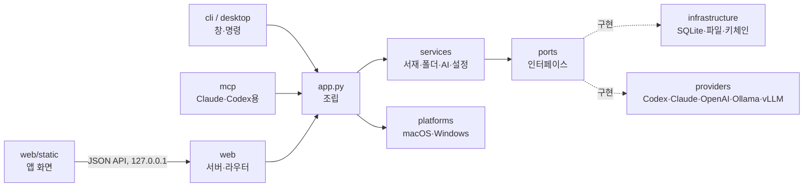

# Paperdesk

내 컴퓨터(macOS·Windows)에서 논문 PDF를 주제별 폴더로 정리하고, 읽다가 막히는 부분을 바로 번역·설명·질문하는 데스크톱 앱입니다.
AI는 이미 쓰고 있는 것을 연결합니다: Codex·Claude Code 로그인, OpenAI·Claude API 키, 내 컴퓨터의 Ollama, 회사·학교의 vLLM 서버.
논문과 설정은 모두 내 컴퓨터에만 저장됩니다.

> 작업용 이름입니다. 화면 이름은 `src/paperdesk/__init__.py`의 `APP_NAME`에서 바꿉니다. 영구 저장·키체인·번들 식별자는 이름과 별도로 고정합니다.

## 로컬 실행과 저장

Paperdesk는 설치한 컴퓨터에서 실행됩니다. `paperdesk`를 실행하면 앱 내부 통신용 `127.0.0.1` 프로세스와 네이티브 창이 함께 시작되고, 창을 닫으면 종료됩니다. 별도의 서버 운영이나 원격 서버 접속이 필요하지 않습니다. 화면 라이브러리와 언어 파일도 앱 패키지에 포함됩니다.

데이터 폴더는 macOS `~/Library/Application Support/Paperdesk`, Windows `%LOCALAPPDATA%\Paperdesk`입니다. 앱 업데이트 때 기록을 유지하도록 실행 파일과 사용자 데이터를 분리합니다.

| 저장 항목 | 위치 |
| --- | --- |
| PDF 원본 | `files/` |
| 서재·폴더·번역·하이라이트·메모·AI 대화·화면 설정 | `library.sqlite3` |
| AI 연결 설정·화면 언어·답변 언어 | `settings.json` |
| API 키 | macOS 키체인 / Windows 자격 증명 관리자 |

앱을 다시 열거나 내부 실행 포트가 바뀌어도 기록을 불러옵니다. 예전 버전의 브라우저 저장소에 있던 대화와 화면 설정은 같은 실행 주소에서 업데이트를 처음 열 때 앱 DB로 옮깁니다. 성공한 항목만 예전 저장소에서 지우며, 이미 DB에 있는 최신 기록이나 사용자가 비운 대화를 덮어쓰지 않습니다. 논문별 대화는 최근 80개까지 저장합니다.

PDF 읽기, 그림·참고문헌 미리보기, 저장된 번역·대화·메모 열람은 오프라인으로 동작합니다. 외부 연결은 선택한 클라우드 AI(API·Codex CLI·Claude Code), 논문 검색·다운로드(arXiv·OpenAlex), 사용자가 누르는 DOI·Scholar 링크 등에 사용됩니다. 참고문헌의 초록 조회와 AI 설명도 버튼을 눌렀을 때 수행합니다. Ollama나 vLLM을 내 컴퓨터에 연결하면 새 AI 작업도 로컬에서 처리할 수 있습니다.

## 설치 (macOS)

아래 명령의 `OWNER`는 실제 배포 계정으로 바꿔야 합니다. 아직 공개된 Homebrew 저장소나 DMG는 없습니다.

배포용 앱은 Cask로 설치·업데이트합니다. `.app`에는 Python과 필요한 라이브러리가 포함됩니다.

```sh
brew install --cask OWNER/tap/paperdesk
brew upgrade --cask paperdesk
```

소스/CLI 설치용 Formula 틀도 유지합니다.

```sh
brew tap OWNER/paperdesk https://github.com/OWNER/homebrew-paperdesk
brew install paperdesk
paperdesk            # 앱 창 열기
```

## 소스로 설치 (베타, macOS·Windows)

서명된 설치 파일이 나오기 전까지는 이 저장소에서 직접 설치합니다. 설치 스크립트가 별도 Python 환경을 만들고 배포 빌드와 같은 고정 버전(네이티브 창, Docling 분석, 약 1.3GB)을 설치합니다. 서재는 데이터 폴더에 따로 있어 업데이트·제거해도 유지됩니다.

**Windows 10/11 (x64)**

1. [python.org](https://www.python.org/downloads/windows/)의 Python 3.12를 설치합니다(`winget install Python.Python.3.12`). uv·conda가 설치한 Python은 서명이 없어 아래 Smart App Control에 막힐 수 있습니다.
2. 저장소를 받습니다(`git clone` 또는 ZIP).
3. 저장소 폴더에서 설치합니다. 시작 메뉴에 **Paperdesk (beta)**가 생깁니다.

```bat
py -3.12 scripts\install_source.py
```

**macOS (Apple Silicon)**

```sh
brew install python@3.12
python3.12 scripts/install_source.py
~/.paperdesk-beta/venv/bin/python -m paperdesk     # 앱 창 열기
```

- 업데이트: 설치할 때 자동 업데이트를 켤지 한 번 묻습니다(`--auto-update`/`--no-auto-update`로 미리 정할 수 있음). 설치 스크립트는 저장소의 origin을 설치 폴더 안에 따로 받아(`source`) 그 사본을 설치하므로, 개발 중인 작업 폴더는 건드리지 않습니다. 켜 두면 앱이 실행 중에 GitHub에서 새 커밋만 받아 두고(git이 바뀐 부분만 전송), 다음에 앱을 열 때 창을 띄우기 전에 적용한 뒤 다시 시작합니다. 고정 버전 목록(`requirements/*.lock`)이 바뀐 커밋에서만 패키지를 다시 받으며, 적용에 실패하면 이전 커밋으로 되돌려 실행합니다. 꺼 두면 설정 → **업데이트 확인**으로 받을 때만 적용됩니다. git이나 origin이 없으면(ZIP으로 받은 경우 등) 예전처럼 이 폴더를 그대로 설치하며, 이때는 `git pull` 후 설치 명령을 다시 실행합니다.
- 제거: 설치 명령에 `--uninstall`을 붙입니다.
- Claude 데스크톱·Codex 연결: 설치가 끝나면 표시되는 `... -m paperdesk mcp-config claude`(또는 `codex`) 결과를 각 앱 설정에 넣습니다.

> **Windows Smart App Control**: Windows 11에서 이 기능이 켜져 있으면 서명이 없는 프로그램은 직접 빌드한 것이라도 "그래도 실행" 없이 차단됩니다(SmartScreen 경고와 다릅니다). 소스 설치는 서명된 python.org `python.exe`로 실행되므로 동작합니다. 함께 설치되는 라이브러리의 DLL은 Microsoft 평판으로 판정되어, 처음 한 번 막혔다가 다시 시도하면 통과하는 경우가 있습니다. 논문 분석이 실패하면 리더에서 다시 시도해 주세요. 막힌 파일은 이벤트 뷰어의 `Microsoft-Windows-CodeIntegrity/Operational`(이벤트 3077)에서 확인할 수 있습니다.

## 주요 기능

- 주제별 폴더(하위 폴더 무제한), 끌어다 놓기로 정리·가져오기, 폴더를 지워도 논문은 상위 폴더로 이동
- PDF 가져오기: 파일명 대신 메타데이터·첫 페이지의 논문 제목을 찾아 서재 이름으로 자동 적용합니다. 직접 바꾼 이름과 원본 파일은 유지합니다.
- PDF 읽기: 연결한 AI로 미번역 본문 전체를 자동 번역(설정에서 켜기/끄기, 완료한 문단부터 표시), 글 선택 → 번역(T)·설명(E)·질문(Q), 논문 요약, 본문 전체 검색
- 논문마다 따로 저장되는 AI 대화, 같은 요청은 로컬 캐시로 재사용
- 시스템 연동·다크·라이트 테마, 회색 반투명 창(macOS 흐림 효과)
- 화면 언어: 한국어·English·日本語·简体中文 (처음에는 시스템 언어를 따르고 설정에서 변경). 번역·답변 언어는 따로 고릅니다.
- Claude 데스크톱·Codex가 내 논문을 읽을 수 있는 MCP 서버 (`paperdesk mcp-config claude|codex`)

## AI 연결

| 연결 | 인증 | 근거 |
| --- | --- | --- |
| Codex CLI | 사용자가 직접 한 `codex login` | OpenAI가 안내하는 비대화형 실행(`codex exec`) |
| Claude Code | 사용자가 직접 한 Claude Code 로그인 | 수정하지 않은 Claude Code에 사용자가 직접 로그인하는 것은 허용 |
| OpenAI API / Claude API | 내 API 키 (키체인 보관) | 각 사 권장 방식 |
| Ollama / vLLM·OpenAI 호환 서버 | 없음 또는 서버 키 | OpenAI 호환 Chat Completions |

Paperdesk는 Codex·Claude 로그인 정보를 읽거나 저장하지 않습니다. 자세한 근거와 링크는 [docs/ai-integrations.md](docs/ai-integrations.md)에 있습니다.

체험용 가짜 응답과 미완성 연결은 배포 앱에서 제공하지 않습니다. 테스트용 응답기는 `tests/fixtures.py`, 미출시 실험은 `experiments/`에만 보관하며 앱 패키지에는 포함하지 않습니다.

## 구조



- `domain`: 데이터 모델과 오류. 디스크·네트워크를 모릅니다.
- `ports`: 서비스가 의존하는 인터페이스(`AIProvider`, `DocumentRepository`, `SecretStore` …).
- `providers`: AI 연결. 새 연결은 `AIProvider`를 상속해 `options`를 선언하고 `registry.py`에 등록하면 설정 화면이 자동으로 만들어집니다.
- `platforms`: 운영체제별 차이(데이터 폴더, 키 저장소, 창 효과, 첫 실행 언어). 공통 화면·서버·DB·백업 형식은 OS별로 나누지 않습니다.
- `desktop`: 창 띄우기(`NativeWindowShell` = pywebview, 개발용 `BrowserShell`).

## 개발

```sh
PYTHONPATH=src python3 -m paperdesk serve      # 브라우저로 http://127.0.0.1:47615
PYTHONPATH=src python3 -m paperdesk doctor     # 설치·AI 연결 점검
PYTHONPATH=src python3 -m unittest discover -s tests -t .
pip install -e '.[native,analysis]'                      # macOS 네이티브 창 개발
```

데이터 폴더는 `PAPERDESK_HOME`으로 바꿀 수 있습니다.

Playwright와 Chromium이 설치된 개발 환경에서는 `node tests/browser/local_state.cjs`로 외부 통신 차단, 이전 기록 이전, 대화 중 논문 전환, 앱 재실행·포트 변경 후 기록 복원을 검사합니다. 테스트는 임시 데이터 폴더를 사용합니다. 별도 설치 경로를 쓸 때는 `PAPERDESK_PLAYWRIGHT_MODULE`과 `PAPERDESK_CHROMIUM`을 지정할 수 있고, 실제 PDF를 검사하려면 `PAPERDESK_TEST_PDF`를 지정합니다.

### 화면 문구 번역

원문은 한국어이고 그 문장이 그대로 메시지 ID입니다(gettext 방식). 화면은 `t("{n}편 추가", { n: 3 })`, 서버는 `_("폴더를 찾지 못했어요.")`로 감싸고, 번역은 `src/paperdesk/web/static/i18n/<언어>.json`에 둡니다. 서버는 `X-Paperdesk-Lang`(없으면 `Accept-Language`)으로 오류 메시지와 AI 연결 설명을 번역해 보냅니다.

```sh
python3 scripts/i18n.py check          # 빠진 문구·안 쓰는 문구·{자리표시자} 불일치 검사
python3 scripts/i18n.py missing ja     # 번역이 필요한 문구 출력
```

새 언어는 `i18n/<코드>.json`을 만들고 `js/i18n.js`의 `LANGUAGES`와 `src/paperdesk/i18n.py`의 `SUPPORTED`에 코드를 추가합니다.

## 배포

### macOS 앱·DMG·업데이트

설정의 **정보·업데이트**에서 새 버전을 확인하고, 배포용 macOS 앱은 Sparkle의 안내로 다운로드·설치·재실행할 수 있도록 연결했습니다. 자동 확인은 사용자가 켜며, 설치에는 확인이 필요합니다. 개발 실행이나 배포 주소/서명 키가 없는 빌드는 업데이트 불가 상태를 표시합니다. 실제 설치·재실행은 서명된 Mac 빌드로 검증해야 합니다.

`scripts/build_macos.py`는 앱·아이콘·Sparkle을 묶고 서명·공증·DMG 생성을 수행합니다. `scripts/release_macos.py`는 최종 DMG로 서명된 업데이트 피드와 Homebrew Cask를 준비합니다. 빌드 번호는 매번 증가시키며 사용자 데이터는 앱과 별도 보관합니다. DB 스키마 변경 전에는 `backups/migrations/`에 자동 백업하고, 마이그레이션 실패는 롤백합니다.

Mac 준비, 키 설정, 빌드·배포 명령과 검증 범위는 [docs/macos-updates.md](docs/macos-updates.md)에 있습니다. 스크립트는 로컬 파일만 준비하며 GitHub 릴리스·업데이트 피드·Homebrew 저장소에 자동 게시하지 않습니다.

### Windows 설치 파일

`scripts/build_windows.py --development`가 PyInstaller로 `Paperdesk.exe`(창)·`paperdesk-cli.exe`(콘솔: MCP·doctor·backup)와 Docling 분석 런타임(`scripts/build_analysis_runtime.py`)을 묶고, Inno Setup(`packaging/windows/paperdesk.iss`)으로 관리자 권한이 필요 없는 사용자 설치 파일을 만듭니다(`%LOCALAPPDATA%\Programs\Paperdesk`, WebView2가 없을 때만 설치 중 내려받기). 고정 버전은 `requirements/windows-build.lock`과 `requirements/docling-windows.lock`(macOS와 같은 Docling 버전)입니다. Smart App Control 때문에 공개 배포 전에는 모든 실행 파일·DLL과 설치 파일의 Authenticode 서명이 필요하며, 서명과 WinSparkle 업데이트는 아직 연결하지 않았습니다.

### 소스/CLI Formula

1. 버전 올리기(`__version__`) → 태그 `vX.Y.Z` push
2. Mac에서 `python3 scripts/release.py --repo OWNER/paperdesk --license <SPDX>`
3. `brew update-python-resources --print-only Formula/paperdesk.rb` 결과를 파일로 저장해 `--resources`로 다시 렌더링
4. `Formula/paperdesk.rb`를 tap 저장소(`homebrew-paperdesk`)에 올리고 `brew install --build-from-source`·`brew test`·`brew audit --strict`

## 라이선스

프로젝트는 [Apache License 2.0](LICENSE)로 배포합니다. 제3자 소프트웨어에는 각각의 라이선스가 적용되며 [THIRD_PARTY_NOTICES.md](THIRD_PARTY_NOTICES.md)와 앱에 포함된 라이선스 파일에서 확인할 수 있습니다.

## 배포 준비와 운영

현재 공개 배포 전 베타 단계입니다. 첫 배포 대상은 Apple Silicon·macOS 15 이상이며, 실제 최저 버전과 별도 깨끗한 Mac 검증은 릴리스 조건입니다. 자세한 지원 범위와 실패·복구 동작은 [지원 안내](docs/support.md), 전송 범위는 [개인정보 안내](docs/privacy.md), 배포 소유자 작업과 통과 기준은 [배포 준비](docs/release-readiness.md)에 정리했습니다.

- AI 설정의 **설치·모델 확인**은 CLI 버전과 Codex 지원 모델을 확인합니다. 로그인 확인과 실제 연결 시험은 구분하며, 모델이나 유료 연결을 자동으로 바꾸지 않습니다.
- 본문 번역은 DB 작업으로 보관합니다. 창을 이동해도 진행하며, 재시작 후 중단 작업은 번역 메뉴에서 확인하고 재개합니다. 이미 보낸 요청의 사용량은 취소할 수 없을 수 있습니다. 기존 번역을 바꾸려면 **현재 쪽 다시 번역**을 명시적으로 선택합니다.
- 설정의 **백업·복원**은 PDF·메모·번역·대화·설정을 함께 다룹니다. 키와 로그인 정보는 제외합니다. 복원 확인 후 완전히 재시작하면 적용하며 이전 서재 전체는 별도 폴더에 보존합니다. 큰 백업은 `paperdesk backup export|inspect|restore`를 사용합니다.
- 앱 표시 이름과 데이터·키체인 식별자를 분리했습니다. 이름을 바꿔도 기존 `~/Library/Application Support/Paperdesk`를 계속 사용합니다.
- 배포 빌드는 `requirements/macos-build.lock`의 고정 버전을 검사하고 앱에 빌드 명세를 포함합니다. 공개 릴리스 생성에는 프로젝트 LICENSE와 해당 빌드의 완료된 수동 검증 기록이 필요합니다. 서명·공증·실제 업데이트를 검증하기 전에는 공개 배포 완료로 표시하지 않습니다.

문서 구조 분석은 로컬 Docling 2.142.1을 사용하고 PDF.js는 원문 렌더링과 텍스트 선택을 담당합니다. macOS DMG에는 별도 분석용 Python 런타임이 포함되며, 처음 논문을 분석할 때 Heron 모델을 내려받습니다. PDF를 분석 서버로 보내지 않으며 모델 준비 이후에는 오프라인 분석이 가능합니다. 서재와 리더에서 분석·번역 진행 상태를 확인할 수 있습니다. 자동 번역은 기본으로 켜져 있고 설정에서 끌 수 있습니다.

처음에는 로그인된 Codex/Claude CLI를 사용량 없이 확인해 연결과 모델을 선택합니다. Codex는 지원 목록 중 최신 Luna를 우선하고, 저장된 연결·모델은 유지합니다. 로그인된 연결이 없으면 설정에서 로그인 방법과 재확인 버튼을 보여 줍니다.
