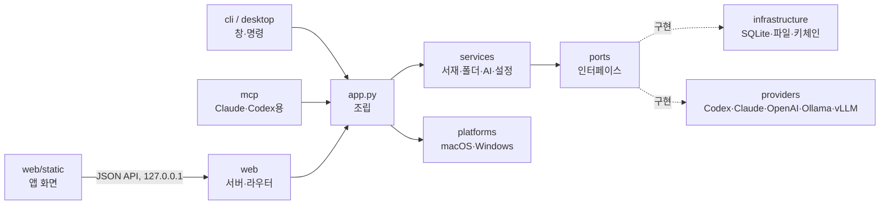

# Paperdesk

내 Mac에서 논문 PDF를 주제별 폴더로 정리하고, 읽다가 막히는 부분을 바로 번역·설명·질문하는 데스크톱 앱입니다.
AI는 이미 쓰고 있는 것을 연결합니다: Codex·Claude Code 로그인, OpenAI·Claude API 키, 내 컴퓨터의 Ollama, 회사·학교의 vLLM 서버.
논문과 설정은 모두 내 컴퓨터에만 저장됩니다.

> 작업용 이름입니다. 이름은 `src/paperdesk/__init__.py`의 `APP_NAME`/`APP_ID` 한 곳에서 바뀝니다.

## 로컬 실행과 저장

Paperdesk는 설치한 컴퓨터에서 실행됩니다. `paperdesk`를 실행하면 앱 내부 통신용 `127.0.0.1` 프로세스와 네이티브 창이 함께 시작되고, 창을 닫으면 종료됩니다. 별도의 서버 운영이나 원격 서버 접속이 필요하지 않습니다. 화면 라이브러리와 언어 파일도 앱 패키지에 포함됩니다.

macOS 데이터 폴더는 `~/Library/Application Support/Paperdesk`입니다. 앱 업데이트 때 기록을 유지하도록 실행 파일과 사용자 데이터를 분리합니다.

| 저장 항목 | 위치 |
| --- | --- |
| PDF 원본 | `files/` |
| 서재·폴더·번역·하이라이트·메모·AI 대화·화면 설정 | `library.sqlite3` |
| AI 연결 설정·화면 언어·답변 언어 | `settings.json` |
| API 키 | macOS 키체인 |

앱을 다시 열거나 내부 실행 포트가 바뀌어도 기록을 불러옵니다. 예전 버전의 브라우저 저장소에 있던 대화와 화면 설정은 같은 실행 주소에서 업데이트를 처음 열 때 앱 DB로 옮깁니다. 성공한 항목만 예전 저장소에서 지우며, 이미 DB에 있는 최신 기록이나 사용자가 비운 대화를 덮어쓰지 않습니다. 논문별 대화는 최근 80개까지 저장합니다.

PDF 읽기, 그림·참고문헌 미리보기, 저장된 번역·대화·메모 열람은 오프라인으로 동작합니다. 외부 연결은 선택한 클라우드 AI(API·Codex CLI·Claude Code), 논문 검색·다운로드(arXiv·OpenAlex), 사용자가 누르는 DOI·Scholar 링크 등에 사용됩니다. 참고문헌의 초록 조회와 AI 설명도 버튼을 눌렀을 때 수행합니다. Ollama나 vLLM을 내 컴퓨터에 연결하면 새 AI 작업도 로컬에서 처리할 수 있습니다.

## 설치 (macOS)

```sh
brew tap OWNER/paperdesk https://github.com/OWNER/homebrew-paperdesk
brew install paperdesk
paperdesk            # 앱 창 열기
```

## 주요 기능

- 주제별 폴더(하위 폴더 무제한), 끌어다 놓기로 정리·가져오기, 폴더를 지워도 논문은 상위 폴더로 이동
- PDF 읽기: 글 선택 → 번역(T)·설명(E)·질문(Q), 논문 요약, 현재 쪽 번역, 본문 전체 검색
- 논문마다 따로 저장되는 AI 대화, 같은 요청은 로컬 캐시로 재사용
- 시스템 연동·다크·라이트 테마, 회색 반투명 창(macOS 흐림 효과)
- 화면 언어: 한국어·English·日本語·简体中文 (처음에는 시스템 언어를 따르고 설정에서 변경). 번역·답변 언어는 따로 고릅니다.
- Claude 데스크톱·Codex가 내 논문을 읽을 수 있는 MCP 서버 (`paperdesk mcp-config claude|codex`)

## AI 연결

| 연결 | 인증 | 근거 |
| --- | --- | --- |
| Codex CLI | 사용자가 직접 한 `codex login` | OpenAI가 안내하는 비대화형 실행(`codex exec`) |
| Claude Code | 사용자가 직접 한 Claude Code 로그인 | 수정하지 않은 Claude Code에 사용자가 직접 로그인하는 것은 허용 |
| ChatGPT 요금제 | Sign in with ChatGPT (구현 예정) | OpenAI의 오픈소스·로컬 앱용 프리뷰 |
| OpenAI API / Claude API | 내 API 키 (키체인 보관) | 각 사 권장 방식 |
| Ollama / vLLM·OpenAI 호환 서버 | 없음 또는 서버 키 | OpenAI 호환 Chat Completions |

Paperdesk는 Codex·Claude 로그인 정보를 읽거나 저장하지 않습니다. 자세한 근거와 링크는 [docs/ai-integrations.md](docs/ai-integrations.md)에 있습니다.

## 구조



- `domain`: 데이터 모델과 오류. 디스크·네트워크를 모릅니다.
- `ports`: 서비스가 의존하는 인터페이스(`AIProvider`, `DocumentRepository`, `SecretStore` …).
- `providers`: AI 연결. 새 연결은 `AIProvider`를 상속해 `options`를 선언하고 `registry.py`에 등록하면 설정 화면이 자동으로 만들어집니다.
- `platforms`: 운영체제별 차이(데이터 폴더, 키 저장소, 창 효과). Windows 지원은 `WindowsPlatform`을 채우면 됩니다.
- `desktop`: 창 띄우기(`NativeWindowShell` = pywebview, 개발용 `BrowserShell`).

## 개발

```sh
PYTHONPATH=src python3 -m paperdesk serve      # 브라우저로 http://127.0.0.1:47615
PYTHONPATH=src python3 -m paperdesk doctor     # 설치·AI 연결 점검
PYTHONPATH=src python3 -m unittest discover -s tests -t .
pip install -e '.[native]'                      # macOS 네이티브 창 개발
```

데이터 폴더는 `PAPERDESK_HOME`으로 바꿀 수 있습니다.

Playwright와 Chromium이 설치된 개발 환경에서는 `node tests/browser/local_state.cjs`로 외부 통신 차단, 이전 기록 이전, 대화 중 논문 전환, 앱 재실행·포트 변경 후 기록 복원을 검사합니다. 테스트는 임시 데이터 폴더를 사용합니다. 별도 설치 경로를 쓸 때는 `PAPERDESK_PLAYWRIGHT_MODULE`과 `PAPERDESK_CHROMIUM`을 지정할 수 있고, 실제 PDF를 검사하려면 `PAPERDESK_TEST_PDF`를 지정합니다.

### 화면 문구 번역

원문은 한국어이고 그 문장이 그대로 메시지 ID입니다(gettext 방식). 화면은 `t("{n}편 추가", { n: 3 })`, 서버는 `_("폴더를 찾지 못했어요.")`로 감싸고, 번역은 `src/paperdesk/web/static/i18n/<언어>.json`에 둡니다. 서버는 `X-Paperdesk-Lang`(없으면 `Accept-Language`)으로 오류 메시지와 AI 연결 설명을 번역해 보냅니다.

```sh
python3 scripts/i18n.py check          # 빠진 문구·안 쓰는 문구·{자리표시자} 불일치 검사
python3 scripts/i18n.py missing ja     # 번역이 필요한 문구 출력
```

새 언어는 `i18n/<코드>.json`을 만들고 `js/i18n.js`의 `LANGUAGES`와 `src/paperdesk/i18n.py`의 `SUPPORTED`에 코드를 추가합니다.

## 배포

1. 버전 올리기(`__version__`) → 태그 `vX.Y.Z` push
2. Mac에서 `python3 scripts/release.py --repo OWNER/paperdesk --license <SPDX>`
3. `brew update-python-resources --print-only Formula/paperdesk.rb` 결과를 파일로 저장해 `--resources`로 다시 렌더링
4. `Formula/paperdesk.rb`를 tap 저장소(`homebrew-paperdesk`)에 올리고 `brew install --build-from-source`·`brew test`·`brew audit --strict`

## 라이선스

공개 전에 라이선스를 정하세요. 의존성이 모두 허용형(Apache-2.0, BSD, MIT)이라 MIT나 Apache-2.0을 그대로 쓸 수 있습니다. 제3자 고지는 [THIRD_PARTY_NOTICES.md](THIRD_PARTY_NOTICES.md)에 있습니다.
