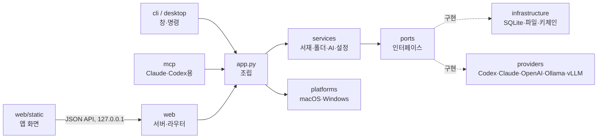

# 개발·배포 안내

사용자용 소개는 [README](../README.ko.md), 설치 방법은 [INSTALL.md](../INSTALL.md)에 있습니다. 이 문서는 구조, 개발 환경, 빌드·배포 절차를 정리합니다.

> 작업용 이름입니다. 화면 이름은 `src/paperdesk/__init__.py`의 `APP_NAME`에서 바꿉니다. 영구 저장·키체인·번들 식별자는 이름과 별도로 고정합니다.

## 구조



- `domain`: 데이터 모델과 오류. 디스크·네트워크를 모릅니다.
- `ports`: 서비스가 의존하는 인터페이스(`AIProvider`, `DocumentRepository`, `SecretStore` …).
- `providers`: AI 연결. 새 연결은 `AIProvider`를 상속해 `options`를 선언하고 `registry.py`에 등록하면 설정 화면이 자동으로 만들어집니다.
- `platforms`: 운영체제별 차이(데이터 폴더, 키 저장소, 창 효과, 첫 실행 언어). 공통 화면·서버·DB·백업 형식은 OS별로 나누지 않습니다.
- `desktop`: 창 띄우기(`NativeWindowShell` = pywebview, 개발용 `BrowserShell`).

## 개발

```sh
PYTHONPATH=src python3 -m paperdesk serve      # 브라우저로 http://127.0.0.1:47615
PYTHONPATH=src python3 -m paperdesk doctor     # 설치·AI 연결 점검
PYTHONPATH=src python3 -m unittest discover -s tests -t .
pip install -e '.[native,analysis]'                      # macOS 네이티브 창 개발
```

데이터 폴더는 `PAPERDESK_HOME`으로 바꿀 수 있습니다.

Playwright와 Chromium이 설치된 개발 환경에서는 `node tests/browser/local_state.cjs`로 외부 통신 차단, 이전 기록 이전, 대화 중 논문 전환, 앱 재실행·포트 변경 후 기록 복원을 검사합니다. 테스트는 임시 데이터 폴더를 사용합니다. 별도 설치 경로를 쓸 때는 `PAPERDESK_PLAYWRIGHT_MODULE`과 `PAPERDESK_CHROMIUM`을 지정할 수 있고, 실제 PDF를 검사하려면 `PAPERDESK_TEST_PDF`를 지정합니다.

### 화면 문구 번역

원문은 한국어이고 그 문장이 그대로 메시지 ID입니다(gettext 방식). 화면은 `t("{n}편 추가", { n: 3 })`, 서버는 `_("폴더를 찾지 못했어요.")`로 감싸고, 번역은 `src/paperdesk/web/static/i18n/<언어>.json`에 둡니다. 서버는 `X-Paperdesk-Lang`(없으면 `Accept-Language`)으로 오류 메시지와 AI 연결 설명을 번역해 보냅니다.

```sh
python3 scripts/i18n.py check          # 빠진 문구·안 쓰는 문구·{자리표시자} 불일치 검사
python3 scripts/i18n.py missing ja     # 번역이 필요한 문구 출력
```

새 언어는 `i18n/<코드>.json`을 만들고 `js/i18n.js`의 `LANGUAGES`와 `src/paperdesk/i18n.py`의 `SUPPORTED`에 코드를 추가합니다.

## 로컬 실행과 저장

Paperdesk는 설치한 컴퓨터에서 실행됩니다. `paperdesk`를 실행하면 앱 내부 통신용 `127.0.0.1` 프로세스와 네이티브 창이 함께 시작되고, 창을 닫으면 종료됩니다. 별도의 서버 운영이나 원격 서버 접속이 필요하지 않습니다. 화면 라이브러리와 언어 파일도 앱 패키지에 포함됩니다.

데이터 폴더는 macOS `~/Library/Application Support/Paperdesk`, Windows `%LOCALAPPDATA%\Paperdesk`입니다. 앱 업데이트 때 기록을 유지하도록 실행 파일과 사용자 데이터를 분리합니다.

| 저장 항목 | 위치 |
| --- | --- |
| PDF 원본 | `files/` |
| 서재·폴더·번역·하이라이트·메모·AI 대화·화면 설정 | `library.sqlite3` |
| AI 연결 설정·화면 언어·답변 언어 | `settings.json` |
| API 키 | macOS 키체인 / Windows 자격 증명 관리자 |

앱을 다시 열거나 내부 실행 포트가 바뀌어도 기록을 불러옵니다. 예전 버전의 브라우저 저장소에 있던 대화와 화면 설정은 같은 실행 주소에서 업데이트를 처음 열 때 앱 DB로 옮깁니다. 성공한 항목만 예전 저장소에서 지우며, 이미 DB에 있는 최신 기록이나 사용자가 비운 대화를 덮어쓰지 않습니다. 논문별 대화는 최근 80개까지 저장합니다.

PDF 읽기, 그림·참고문헌 미리보기, 저장된 번역·대화·메모 열람은 오프라인으로 동작합니다. 외부 연결은 선택한 클라우드 AI(API·Codex CLI·Claude Code), 논문 검색·다운로드(arXiv·OpenAlex), 사용자가 누르는 DOI·Scholar 링크 등에 사용됩니다. 참고문헌의 초록 조회와 AI 설명도 버튼을 눌렀을 때 수행합니다. Ollama나 vLLM을 내 컴퓨터에 연결하면 새 AI 작업도 로컬에서 처리할 수 있습니다.

## AI 연결 구현 메모

체험용 가짜 응답과 미완성 연결은 배포 앱에서 제공하지 않습니다. 테스트용 응답기는 `tests/fixtures.py`, 미출시 실험은 `experiments/`에만 보관하며 앱 패키지에는 포함하지 않습니다.

## 배포

지금은 소스 설치만 제공합니다([INSTALL.md](../INSTALL.md), `scripts/install_source.py`). 설치본은 앱 전용 git 사본을 editable로 설치하고, 앱이 실행 중에 새 커밋을 받아 두었다가 다음 실행 때 적용합니다(`infrastructure/source_update.py`). DB 스키마 변경 전에는 `backups/migrations/`에 자동 백업하고, 마이그레이션 실패는 롤백합니다.

패키지 배포(macOS DMG와 Sparkle 업데이트, Windows 설치 파일, Homebrew)는 첫 정식 배포 때 다시 넣습니다. 마지막 구현은 커밋 `5a339e5`에 있습니다: `scripts/build_*.py`, `scripts/release*.py`, `packaging/`의 빌드 파일, `requirements/*-build.lock`, `infrastructure/macos_updates.py`, `docs/macos-updates.md`, `docs/release-readiness.md`. 되살릴 때는 이를 뺀 커밋을 되돌리면 됩니다.

## 운영 메모

현재 베타이며 소스 설치(Apple Silicon·macOS 15 이상, Windows 10/11 x64)를 지원합니다. 자세한 지원 범위와 실패·복구 동작은 [지원 안내](support.md), 전송 범위는 [개인정보 안내](privacy.md)에 있습니다.

- AI 설정의 **설치·모델 확인**은 CLI 버전과 Codex 지원 모델을 확인합니다. 로그인 확인과 실제 연결 시험은 구분하며, 모델이나 유료 연결을 자동으로 바꾸지 않습니다.
- 본문 번역은 DB 작업으로 보관합니다. 창을 이동해도 진행하며, 재시작 후 중단 작업은 번역 메뉴에서 확인하고 재개합니다. 이미 보낸 요청의 사용량은 취소할 수 없을 수 있습니다. 기존 번역을 바꾸려면 **현재 쪽 다시 번역**을 명시적으로 선택합니다.
- 설정의 **백업·복원**은 PDF·메모·번역·대화·설정을 함께 다룹니다. 키와 로그인 정보는 제외합니다. 복원 확인 후 완전히 재시작하면 적용하며 이전 서재 전체는 별도 폴더에 보존합니다. 큰 백업은 `paperdesk backup export|inspect|restore`를 사용합니다.
- 앱 표시 이름과 데이터·키체인 식별자를 분리했습니다. 이름을 바꿔도 기존 `~/Library/Application Support/Paperdesk`를 계속 사용합니다.

문서 구조 분석은 로컬 Docling 2.142.1을 사용하고 PDF.js는 원문 렌더링과 텍스트 선택을 담당합니다. 소스 설치는 Docling을 앱과 같은 Python 환경에 설치하며, 처음 논문을 분석할 때 Heron 모델을 내려받습니다. PDF를 분석 서버로 보내지 않으며 모델 준비 이후에는 오프라인 분석이 가능합니다. 서재와 리더에서 분석·번역 진행 상태를 확인할 수 있습니다. 자동 번역은 기본으로 켜져 있고 설정에서 끌 수 있습니다.

처음에는 로그인된 Codex/Claude CLI를 사용량 없이 확인해 연결과 모델을 선택합니다. Codex는 지원 목록 중 최신 Luna를 우선하고, 저장된 연결·모델은 유지합니다. 로그인된 연결이 없으면 설정에서 로그인 방법과 재확인 버튼을 보여 줍니다.
